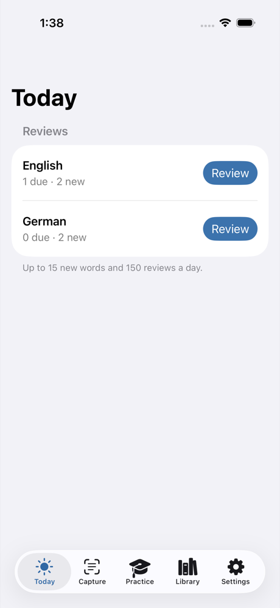
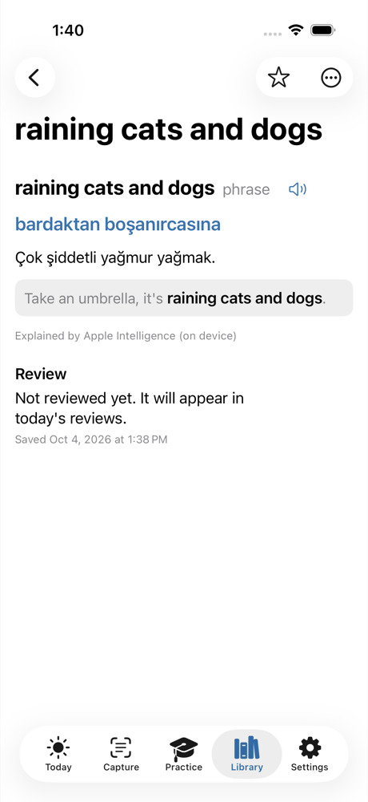
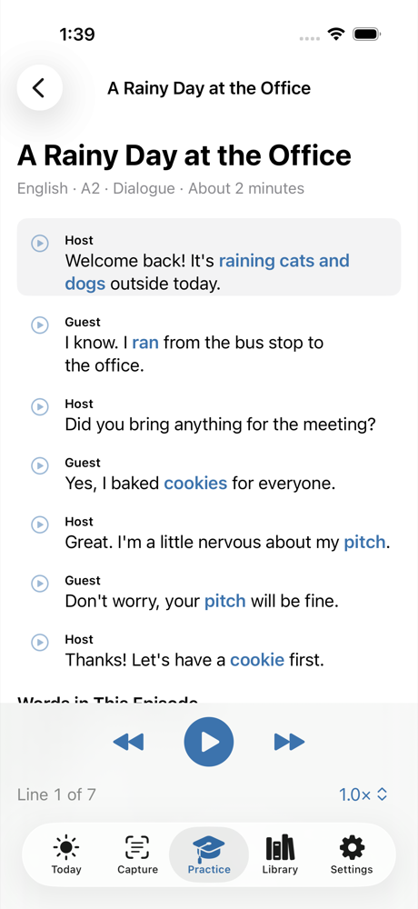
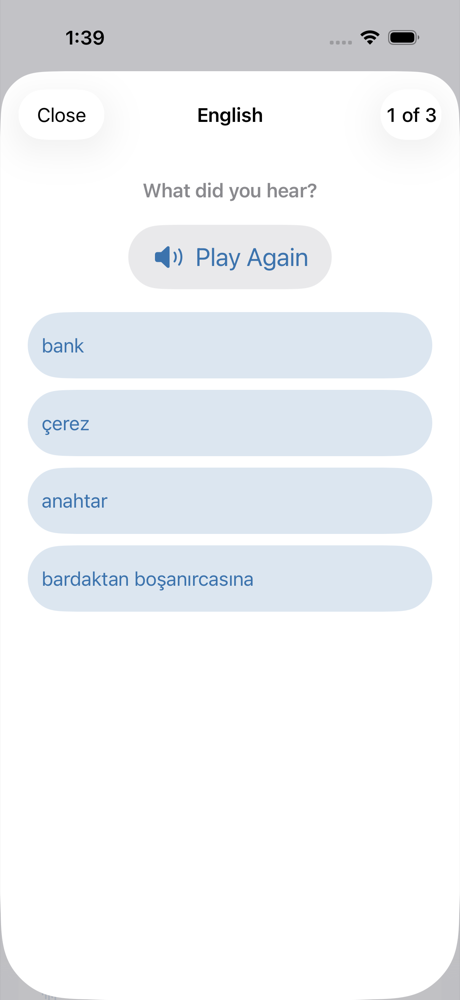
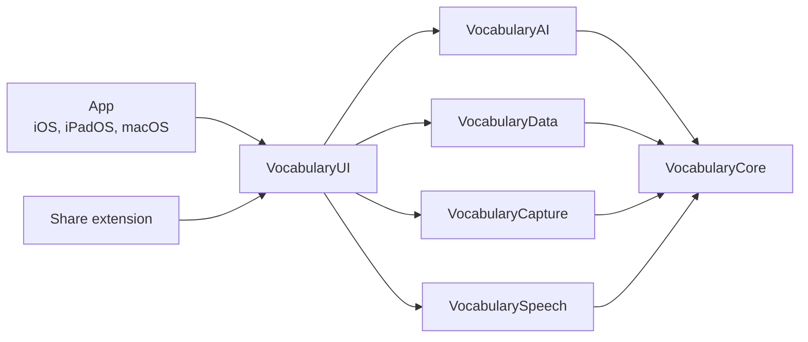

# Vocabulary-OS

Learn words where you meet them. Vocabulary-OS is a free, open-source vocabulary app for iPhone, iPad
and Mac. Capture a word from a sentence in any app, a page of a paper book or an object in front of
you, and see what it means **in that sentence**, explained in your native language. Then review it
with spaced repetition, AI-generated quizzes and AI-generated podcasts, on a schedule you plan.

- **No server.** Your words live in your private iCloud and sync across your devices.
- **Your choice of AI.** Apple's on-device model works by default, with no key. You can also connect
  one of 16 cloud providers, such as OpenAI, Anthropic, Google Gemini or Mistral, with your own API
  key, or add your own, such as Ollama on your Mac.
- **Several languages at once.** Learning English and German at the same time? Words are routed to
  the right language automatically.

<p align="center">
  
  
  
  
</p>
<p align="center">
  <em>The iPhone app with sample words, for a Turkish speaker learning English and German.</em>
</p>

> **Status:** version 0.1, feature complete for v1. It is not on the App Store yet: iCloud sync, the
> camera and the cloud providers still need checks with a signed build on real devices, as the
> [ship review](docs/ship-review.md) lists.

## Features

- **Capture text anywhere.** Paste text in the app, share selected text from any app's share sheet
  on iPhone, iPad and Mac, or on a Mac use **Services → Capture in Vocabulary-OS**. Tap a word or
  drag across a phrase; the sentence around it becomes the context.
- **Capture from paper and the room.** Photograph a book page and tap a word: its sentence is the
  context, even when it wraps across lines. Photograph an object to learn its name, with its article
  where the language has one. Photos are recognized on the device; one goes to your AI provider only
  if you turn that on, so a cloud model can see what you photographed.
- **Meaning in context.** The dictionary form, part of speech, a short translation and what the word
  means in this sentence, in your native language, then a grammar note, examples and other common
  meanings.
- **Library.** Words grouped by language, with search, filters (new, due, favorites, mastered),
  sorting, named lists, editing and listening.
- **Review.** Flashcards scheduled with SM-2 and four ratings. The Today screen shows what is due in
  each language and today's plans.
- **Quizzes.** Meaning, reverse, fill-in-the-blank and listening questions written by the AI from
  your words. Each question is checked before you see it, and your answers update your reviews.
- **Podcasts.** A dialogue between two hosts, or a story, at your level, using the words you
  choose. It is spoken with the voices on your device and keeps playing with the screen locked. The
  transcript highlights your words and opens them.
- **Plans.** Recurring review, quiz or podcast sessions. A reminder opens the activity, ready to
  start.
- **Sharing.** Export a list or a language as a `.vocabularyos` file or as CSV. Opening a file
  imports it and skips the words you already have.
- **For everyone.** English and Turkish, Dynamic Type and VoiceOver, on iPhone, iPad and Mac.

## AI providers

| Provider | What you need |
| --- | --- |
| Apple Intelligence (on device), the default | A device with Apple Intelligence turned on. No key, no account. |
| OpenAI, Anthropic Claude, Google Gemini, xAI Grok, DeepSeek, Mistral, Alibaba Qwen, Moonshot Kimi, Z.ai GLM, Cohere, Groq, Cerebras, Together AI, Fireworks AI, Hugging Face, OpenRouter | Your own API key. Each provider's page in Settings links to where you create one. |
| Your own: any service with an OpenAI-compatible API | A name, its address and a key if it needs one: for example Ollama or LM Studio on your Mac, Azure OpenAI, Amazon Bedrock or your company's gateway. Plain `http` works only on your own device and network. |

One provider and model is active at a time. A failed request says why, and the app never switches
providers on its own. Before the first request to a cloud provider, the app tells you what is sent:
the word, its sentence and your languages' names, and object photos only if you turn that on. The
on-device model works best with small, focused prompts, so a cloud model gives better results for
rare senses and idioms; the measurements are in [`docs/eval`](docs/eval).

## Requirements

- A Mac with macOS 26 and Xcode 26.2 or newer.
- [XcodeGen](https://github.com/yonaskolb/XcodeGen) 2.46 or newer: `brew install xcodegen`.
- To run the app: iOS 26, iPadOS 26 or macOS 26. The on-device AI also needs a device with Apple
  Intelligence turned on; otherwise, connect a cloud provider with your own key.

## Build and run

```bash
git clone https://github.com/FARUK-YILDIRIM/Vocabulary-OS.git
cd Vocabulary-OS
xcodegen generate          # creates VocabularyOS.xcodeproj from project.yml
open VocabularyOS.xcodeproj
```

Run the **VocabularyOS** scheme on an iPhone or iPad simulator, or on "My Mac". No Apple Developer
account is needed for these. Without one, the app is ad-hoc signed, and:

- it keeps its data on the device, with no iCloud sync;
- on the Mac, the Share extension can't hand words to the app and says so; the Services menu still
  works.

The Simulator has no camera: choose a photo instead. Dragging an image file onto the Simulator
window adds it to Photos.

### Build with your own team

iCloud sync, the App Group on the Mac, keychain sharing and running on your own iPhone or iPad need
a signed build. Copy the signing template and fill in your Team ID and a bundle ID prefix you own:

```bash
cp Config/Signing.local.xcconfig.example Config/Signing.local.xcconfig   # gitignored, never commit it
# edit the copy: VOS_DEVELOPMENT_TEAM and VOS_BUNDLE_PREFIX
xcodegen generate
```

The build then uses the App Group `group.<prefix>` and the iCloud container `iCloud.<prefix>`.
With automatic signing, Xcode registers both for your team; if it can't, create them in your
developer account. A new container can take a few minutes before CloudKit knows it.

TestFlight and App Store builds use CloudKit's production environment. Before you distribute a
build, create every record type and field in the development environment, then deploy the schema
to production in the CloudKit Console:

```bash
scripts/mac-smoke.sh --self-test cloudkit-schema   # needs the signed macOS build from verify.sh
```

SwiftData alone creates only the fields it has saved values for, so a field that stayed empty
during development would be missing in production.

## Development

```bash
scripts/verify.sh                                  # the gate before every commit
swift test --package-path Packages/VocabularyKit   # package tests only
scripts/ui-test.sh                                 # UI tests in the iOS Simulator, with screenshots
scripts/mac-smoke.sh                               # launch check of the macOS build
swift run --package-path Packages/VocabularyKit vos-eval insight   # measures the on-device prompts
```

`scripts/verify.sh` regenerates the project, runs the package tests, builds the app for the iOS
Simulator and macOS, and checks that every string has a Turkish translation. It fails on any error,
and on any warning in project code or about the project's targets. Read
[`CONTRIBUTING.md`](CONTRIBUTING.md) before opening a pull request.

## Architecture

Almost all the code lives in the `VocabularyKit` Swift package, so it can be tested on the Mac with
`swift test`. The app and the Share extension are thin SwiftUI layers on top of it.



| Module | Contents |
| --- | --- |
| `VocabularyCore` | Languages and routing, the SM-2 scheduler and daily queue, quiz and podcast validation, plan schedules |
| `VocabularyAI` | One client interface over Apple Foundation Models, OpenAI-compatible APIs and Anthropic; the insight, object, quiz and podcast prompts with their validators; keys in the Keychain |
| `VocabularyData` | SwiftData models synced with CloudKit, repositories, settings in the iCloud key-value store, the Share extension's inbox, word list files and plan reminders |
| `VocabularyCapture` | Text recognition on page photos, object classification and thumbnails, all with Vision |
| `VocabularySpeech` | Voice selection and the speech player for podcasts and listening |
| `VocabularyUI` | View models and views shared by the app and the Share extension |
| `vos-eval` | A command-line evaluation of the on-device prompts against fixtures |

How it fits together:

- A word captured in the app is explained by the selected provider and saved with SwiftData, which
  syncs it through your private CloudKit database.
- The Share extension doesn't write to the store. It saves to an inbox in the App Group, and the
  app imports the inbox when it becomes active.
- Each device schedules its own plan reminders from the synced plans.
- Podcast scripts sync. Their audio is spoken on each device and never uploaded.

| Path | Contents |
| --- | --- |
| `App/` | The multiplatform SwiftUI app |
| `Extensions/ShareExtension/` | The Share extension for iOS, iPadOS and macOS |
| `Packages/VocabularyKit/` | The package above, with its tests |
| `UITests/` | XCUITests for the flows across screens |
| `Config/` | Build settings and entitlements for unsigned (Local) and signed (Full) builds |
| `docs/` | Architecture decision records and prompt evaluations |
| `scripts/` | The verification, UI test and macOS smoke test scripts, and their tools |
| `tasks/` | The implementation plan and progress |

Read [`SPEC.md`](SPEC.md) for what the app does and the ADRs in [`docs/`](docs) for why it is built
this way. [`CLAUDE.md`](CLAUDE.md) holds the rules the AI coding agents follow; human contributors
follow the same ones.

## Privacy

- No analytics, telemetry or tracking, and no server of our own.
- Network requests go only to the AI provider you configure, and only when you use an AI feature.
- API keys are stored in your Keychain and never leave it, except in requests to their own provider.
- Photos leave your device only if you turn on sending object photos to your cloud provider.
- Your words, lists and plans stay on your devices and in your private iCloud database. They leave
  only when you export them, and exported files contain no review history, photos or keys.

The full [privacy policy](PRIVACY.md), in English and Turkish, is the one the App Store links to.
Report security problems privately, as described in [`SECURITY.md`](SECURITY.md).

## License

Vocabulary-OS is released under the [MIT License](LICENSE).
